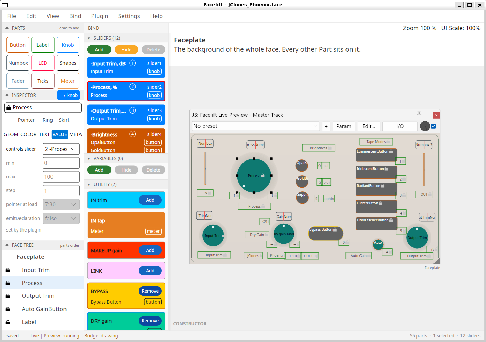
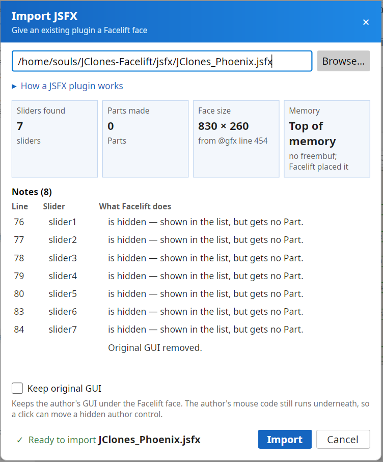
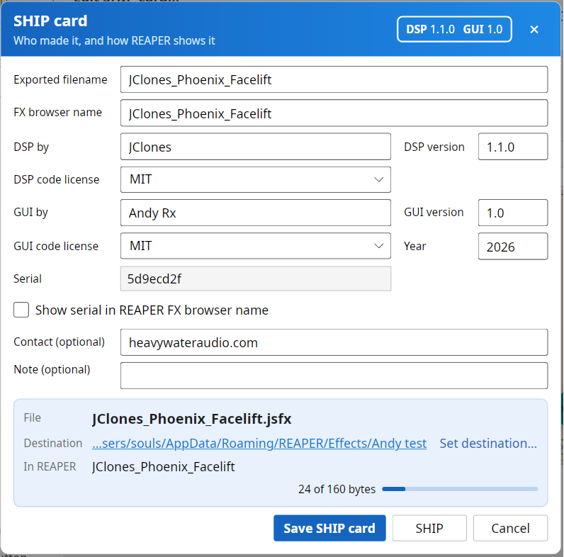
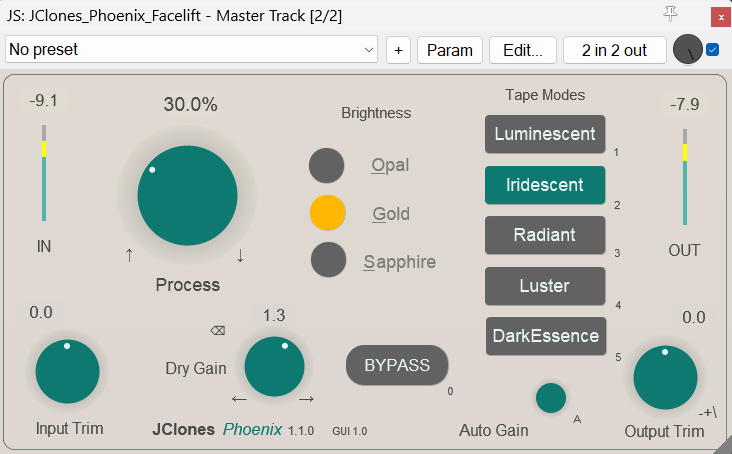

# Facelift

**A visual GUI builder for REAPER JSFX plugins.**

Build a face for any JSFX plugin by drag-and-dropping parts onto it. No gfx code to write.
See every change live in REAPER, drawn with real JSFX pixels.
It's a free desktop app for Windows, macOS and Linux.

*Facelift building the Phoenix face, with the Constructor live preview in the middle.*

## Who it's for

- JSFX developers who want a real GUI without writing drawing code.
- Audio tinkerers who never liked the stock JSFX sliders.
- Parents and kids who want to build a plugin face together on a weekend.

## How it works

1. Install and open Facelift.
2. Open REAPER and run the included `Facelift_Bridge.lua` script.
3. Put the included `Facelift_Preview.jsfx` on a track.
4. In Facelift, import any JSFX plugin. Facelift finds its sliders and binds to parts.
5. Add parts to the face, then place, color and name them.
6. Watch every change in REAPER as you make it.
7. Click **SHIP** to export one `.jsfx` with everything inside, ready to share.

*Importing a plugin: Facelift lists its sliders and keeps your face when the plugin updates.*

*Shipping a plugin: the SHIP card holds the file name, credits, versions and licenses.*

## Parts you can use

- **Ready:** Button, Label, Knob, Numbox, LED, Meter.
- **Coming soon:** Shapes, Fader, Ticks.

Every control can also get:

- a keyboard key;
- a label and a number box;
- its own colors, hover colors and shapes.

## Example: JClones Phoenix

Most of the free [JClones](https://github.com/JClones/JSFXClones) plugins have no GUI.
Here is Phoenix, a tape saturation plugin, with a second face built in Facelift.

Added with Facelift:

- Bypass button, Dry Gain knob, and IN and OUT meters with number boxes.
- Keyboard keys for every control, shown beside it.
- `-` `+` `\` keys to scale the whole window.

[See the Phoenix page and download it](https://github.com/heavywateraudio/JClones-Facelift/blob/master/JClones_Phoenix_Facelift.md).

## Download

**Free release:** Coming soon

Use it for your own projects, forever.
No internet connection is needed.

## Runs on

- Windows, macOS and Linux.
- Needs .NET. The installer adds it if it's missing.
- Needs REAPER for the live preview.

## Updates and bug reports

- **Help > Check for updates** opens the latest release here.
- **Help > Generate bug report** makes a `bug-report.txt`.

## How it was built

Andy Rx: Built over 4 months in C#, .NET and Avalonia, with AI coding tools.
Every change went through tests, checks and my own review.
Every decision is mine: my taste, my vision, my architecture.
